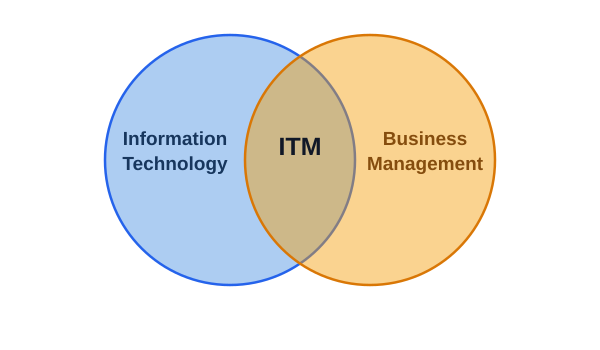

# From Classroom to C-Suite: IT & Management Pathways

- **`Information Technology`** refers to the use of computers, software, networks, databases, and other digital technologies to collect, process, store, secure, and communicate information.

- **`Business Management`** is the process of planning, organizing, directing, and controlling an organization's resources and activities to achieve its goals and objectives efficiently and effectively.

- **`Information Technology Management`** is the process of planning, organizing, directing, and controlling an organization's information technology resources to support its business goals and objectives.

## At its core:

**Information Technology** and **Management** to ensure that technology investments contribute to organizational efficiency, productivity, innovation, and competitive advantage.

ITM involves making strategic decisions about:

- **Technology selection:** Determining which hardware, software, and digital technologies best meet organizational needs.
- **Technology deployment:** Implementing IT systems efficiently while minimizing disruption to business operations.
- **IT resource management:** Managing IT infrastructure, personnel, budgets, and other resources.
- **Business alignment:** Ensuring that IT strategies support the organization's overall goals.
- **Security and risk management:** Protecting organizational information and technology systems against cyber threats and data loss.
- **Performance evaluation:** Measuring the impact of IT investments on productivity, customer satisfaction, and business performance.

IT managers must understand both the technical architecture of IT systems, such as cloud platforms, databases, networks, and cybersecurity infrastructure, and the business environment in which these systems operate.

# Practical Examples of Information Technology Management

## 1. Retail Business: Customer Relationship Management (CRM)

Imagine a retail company that wants to improve its customer service and increase sales by implementing a new Customer Relationship Management (CRM) system.

The IT department may be responsible for installing and maintaining the software. However, IT management involves much more than installation.

The IT manager must:

- Select a CRM system that meets the company's business requirements.
- Ensure that the CRM integrates with existing inventory and payment systems.
- Train employees to use the new system effectively.
- Manage the implementation budget.
- Protect customers' personal and financial information.
- Evaluate whether the system improves customer satisfaction and retention.

**Business outcome:** The company can better understand customer preferences, provide personalized services, improve sales, and build stronger customer relationships.

## 2. Banking Industry: Mobile Banking Systems

A commercial bank wants to introduce a mobile banking application that allows customers to transfer money, check account balances, and pay bills using their smartphones.

IT management ensures that:

- The mobile application is reliable and user-friendly.
- The application integrates with the bank's existing database and transaction systems.
- Appropriate cybersecurity measures protect customers' accounts.
- The system complies with financial regulations.
- IT infrastructure can support thousands of customers accessing the application simultaneously.

**Business outcome:** Customers enjoy convenient banking services, the bank reduces pressure on physical branches, and operational efficiency improves.

## 3. Healthcare: Hospital Information Management Systems

A hospital decides to implement an electronic health records (EHR) system to replace paper-based patient records.

IT management involves:

- Selecting appropriate healthcare information systems.
- Ensuring that doctors, nurses, and administrative staff can access relevant patient information.
- Protecting confidential medical records.
- Training healthcare professionals.
- Ensuring system availability and data backup.
- Integrating laboratory, pharmacy, billing, and patient registration systems.

**Business outcome:** The hospital improves patient record management, reduces administrative errors, and enables healthcare professionals to access information more efficiently.

## 4. Education: Learning Management Systems (LMS)

A university introduces an online learning platform such as Moodle to support teaching, learning, and assessment.

IT management ensures that:

- The platform meets the university's teaching and learning requirements.
- Students and lecturers can access course materials online.
- The LMS integrates with student registration and academic management systems.
- User accounts and academic records are protected.
- Lecturers and students receive appropriate technical support.

**Business outcome:** The university improves access to educational resources, supports online learning, and enhances teaching and learning efficiency.

## 5. Agriculture: Smart Farming and Artificial Intelligence

An agricultural organization adopts artificial intelligence (AI), sensors, and digital technologies to monitor crops and detect plant diseases.

IT management involves:

- Selecting suitable sensors, cameras, and AI systems.
- Managing the infrastructure required to collect and process agricultural data.
- Ensuring that farmers can access useful information through mobile applications.
- Managing technology costs and maintenance.
- Evaluating whether the technology improves agricultural productivity.

**Business outcome:** Farmers can identify crop diseases earlier, make better farming decisions, reduce potential crop losses, and improve agricultural productivity.

# Key Functional Areas and Responsibilities of an ITM
- ITM handle a diverse set of responsibilities that turn high-level strategies into daily actions.

## 1. IT Strategy and Planning

**IT strategy and planning** involves aligning an organization's technology initiatives with its business objectives through careful analysis, decision-making, and long-term planning.

IT managers evaluate potential technology investments, such as Enterprise Resource Planning (ERP) and Customer Relationship Management (CRM) systems, to determine which solutions will provide the greatest business value.

This process includes **IT portfolio management**, which involves prioritizing competing technology projects based on:

- Expected return on investment (ROI).
- Strategic importance to the organization.
- Availability of financial and human resources.
- Potential risks and challenges.
- Expected benefits to business operations.

**Practical example:**

A financial services company has limited funds and must choose between upgrading its cybersecurity infrastructure and introducing a new internal communication platform.

The IT manager prioritizes the cybersecurity upgrade because it is essential for protecting customer information, preventing cyberattacks, and meeting regulatory requirements.

IT managers also monitor emerging technologies, such as cloud computing, artificial intelligence (AI), and industry-specific software, to identify opportunities for innovation and competitive advantage.

**Key objective:** Ensure that technology investments support business goals and deliver measurable organizational value.

---

## 2. Infrastructure and Operations Management (I&O)

**Infrastructure and Operations Management (I&O)** involves managing, maintaining, and supporting the technological infrastructure and services required for an organization's daily operations.

It includes:

- Physical infrastructure, such as servers, computers, and networking equipment.
- Cloud computing platforms and storage systems.
- Operating systems and enterprise software.
- IT service desks and technical support.
- Network monitoring and system maintenance.

IT managers use **IT Service Management (ITSM)** principles to ensure that technology services are delivered reliably and efficiently.

ITSM commonly involves the following processes:

- **Incident Management:** Restoring normal service as quickly as possible when a system or service fails.
- **Problem Management:** Identifying and addressing the underlying causes of recurring incidents.
- **Change Management:** Managing system updates, upgrades, and modifications while minimizing disruption to business operations.

IT managers also establish **Service Level Agreements (SLAs)**, which define the expected level of service between IT providers and users or customers.

For example, an SLA may specify:

- An email system must maintain 99.9% availability.
- At least 80% of help desk tickets must be resolved within four hours.
- Critical system failures must receive immediate technical attention.

Managers continuously monitor these performance indicators and take corrective action when service standards are not met.

**Practical example:**

A university's online learning platform becomes unavailable during an examination period.

The IT support team investigates the incident and restores the system. IT management coordinates the response, communicates with students and lecturers, and ensures that the platform can accommodate increased traffic.

Afterward, the IT team investigates the cause of the failure and implements measures to prevent similar incidents.

**Key objective:** Ensure that IT systems and services remain reliable, available, secure, and efficient to support daily business operations.

---

## 3. IT Governance, Risk, and Compliance (GRC)

**IT Governance, Risk, and Compliance (GRC)** refers to the policies, processes, and organizational structures used to ensure that IT resources are managed responsibly, securely, and in accordance with business objectives and legal requirements.

It consists of three major components:

### IT Governance

IT governance establishes the policies and decision-making structures that guide how technology is managed within an organization.

It defines:

- Who has authority to make IT decisions.
- How technology investments are approved.
- How IT performance is evaluated.
- How information security policies are implemented.
- How IT resources support organizational objectives.

Frameworks such as [COBIT](https://www.isaca.org/resources/cobit) provide structured approaches to IT governance, helping organizations manage and monitor their technology resources.

### Risk Management

IT risk management involves identifying, assessing, and mitigating potential threats to an organization's technology systems and information.

Common IT risks include:

- Cyberattacks and ransomware.
- Unauthorized access to sensitive information.
- Hardware and software failures.
- Data loss and system outages.
- Human errors and security vulnerabilities.

IT managers implement security controls, conduct regular risk assessments, maintain backup systems, and develop disaster recovery and business continuity plans.

**Practical example:**

A bank identifies the possibility of a ransomware attack that could disrupt its online banking services.

The IT manager introduces multi-factor authentication, regular security updates, data backups, employee cybersecurity training, and incident response procedures to reduce the likelihood and impact of an attack.

### Compliance Management

Compliance management ensures that an organization's IT operations adhere to applicable laws, regulations, industry standards, and internal policies.

Examples include:

- **GDPR (General Data Protection Regulation):** Regulates the processing and protection of personal data in the European Union.
- **HIPAA (Health Insurance Portability and Accountability Act):** Establishes requirements for protecting certain healthcare information in the United States.
- **ISO/IEC 27001:** Provides requirements for establishing and maintaining an Information Security Management System (ISMS).

IT managers must understand the regulations relevant to their organization and implement appropriate policies and controls.

### Ethical and Responsible Technology Management

IT governance also addresses ethical issues associated with technology use, including:

- Employee monitoring and privacy.
- Responsible use of personal data.
- Algorithmic bias in artificial intelligence.
- Transparency and accountability in automated decision-making.
- Environmental sustainability and responsible technology disposal.

**Key objective:** Ensure that IT systems are secure, ethical, legally compliant, and aligned with organizational policies.

---

## 4. Financial Management and Budgeting

**IT financial management** involves planning, allocating, monitoring, and controlling financial resources used to acquire, operate, and maintain technology systems.

IT managers prepare budgets, negotiate vendor contracts, evaluate technology investments, and demonstrate the financial value of IT projects to organizational leadership.

IT expenditure is generally classified into two major categories:

### Capital Expenditures (CapEx)

**Capital Expenditures (CapEx)** refer to spending on acquiring or upgrading long-term assets.

Examples include:

- Purchasing servers and networking equipment.
- Acquiring computer hardware.
- Building a data centre.
- Implementing a major enterprise software system.

These investments typically involve significant upfront costs.

### Operating Expenditures (OpEx)

**Operating Expenditures (OpEx)** refer to recurring costs associated with operating and maintaining IT services.

Examples include:

- Cloud computing subscriptions.
- Software licensing fees.
- IT staff salaries.
- System maintenance and technical support.
- Internet connectivity and electricity costs.

Many organizations use cloud computing services because they can reduce the need for substantial upfront hardware investments and allow businesses to pay for resources as they use them.

However, cloud computing does not always reduce overall costs; IT managers must evaluate the long-term financial implications.

### Total Cost of Ownership (TCO)

**Total Cost of Ownership (TCO)** is the complete cost of acquiring, implementing, operating, maintaining, and eventually replacing a technology solution.

TCO includes:

- Purchase or subscription costs.
- Installation and implementation.
- Employee training.
- Maintenance and technical support.
- Infrastructure and operational expenses.
- Upgrades and eventual replacement.

**Practical example:**

A company is considering two accounting software solutions.

The first solution is free and open-source, while the second requires an annual subscription.

Although the open-source solution has no licensing fee, it may require extensive customization, specialized IT staff, and additional maintenance.

The IT manager compares the total cost of ownership of both solutions before making a recommendation.

### Vendor and Supplier Management

Vendor management involves selecting, evaluating, and maintaining relationships with external technology suppliers.

IT managers:

- Compare vendors and their products.
- Negotiate contracts and pricing.
- Evaluate service quality and reliability.
- Monitor supplier performance.
- Ensure that vendors meet contractual and security requirements.

**Key objective:** Ensure that technology investments remain financially sustainable while delivering maximum value to the organization.

---

# ITM Career Paths and Opportunities

Information Technology Management (ITM) offers diverse career opportunities for graduates interested in technology, business operations, leadership, and strategic decision-making.

ITM professionals work across industries such as banking, healthcare, education, government, agriculture, telecommunications, and technology.

## 1. IT Manager

**Role:** Oversees an organization's IT resources, personnel, infrastructure, and technology systems to ensure they support business objectives.

**Key responsibilities:**
- Manage IT teams and budgets.
- Oversee IT infrastructure and systems.
- Develop technology strategies.
- Ensure information security and system reliability.

**Career opportunities:** Banking, healthcare, government, retail, and technology companies.

## 2. IT Project Manager

**Role:** Plans, coordinates, and manages IT projects from initiation to completion.

**Key responsibilities:**
- Define project objectives and requirements.
- Manage project schedules, budgets, and resources.
- Coordinate technical teams and stakeholders.
- Monitor project progress and deliverables.

**Career opportunities:** Software development companies, IT consultancies, telecommunications, and financial institutions.

## 3. Systems Analyst

**Role:** Examines organizational information systems and recommends improvements to enhance efficiency and business performance.

**Key responsibilities:**
- Analyse business and technical requirements.
- Identify weaknesses in existing systems.
- Recommend suitable technology solutions.
- Coordinate with users, developers, and management.

**Career opportunities:** Organizations implementing or upgrading information systems.

## 4. Network Manager

**Role:** Manages an organization's computer networks to ensure reliable, secure, and efficient communication.

**Key responsibilities:**
- Design and maintain network infrastructure.
- Monitor network performance.
- Manage network security and connectivity.
- Troubleshoot network problems.

**Career opportunities:** Telecommunications, government agencies, large enterprises, and technology companies.

## 5. Cybersecurity Manager

**Role:** Protects an organization's information systems, networks, and digital assets against cyber threats.

**Key responsibilities:**
- Develop cybersecurity strategies and policies.
- Identify and assess security risks.
- Manage security incidents.
- Ensure compliance with security standards and regulations.

**Career opportunities:** Banks, government agencies, healthcare institutions, and cybersecurity firms.

## 6. IT Consultant

**Role:** Advises organizations on how to use technology to improve operations, solve problems, and achieve business objectives.

**Areas of specialization:**
- Digital transformation.
- Cloud computing.
- Cybersecurity.
- Business process automation.
- IT strategy and planning.

**Career opportunities:** IT consulting firms, multinational companies, and independent consulting.

## 7. IT Business Analyst

**Role:** Bridges the gap between business needs and technological solutions by analysing organizational processes and requirements.

**Key responsibilities:**
- Gather business requirements.
- Analyse existing business processes.
- Identify opportunities for improvement.
- Recommend IT solutions that support business goals.

**Career opportunities:** Banking, healthcare, government, insurance, and technology companies.

## 8. Database Administrator (DBA)

**Role:** Manages an organization's databases to ensure data availability, security, integrity, and performance.

**Key responsibilities:**
- Maintain and optimize databases.
- Manage data access and security.
- Perform backups and recovery.
- Monitor database performance.

**Career opportunities:** Financial institutions, hospitals, telecommunications, and organizations with large databases.

## 9. Cloud Solutions Manager

**Role:** Oversees cloud computing services and infrastructure to support organizational operations.

**Key responsibilities:**
- Manage cloud infrastructure and services.
- Plan cloud migration and deployment.
- Monitor cloud performance and costs.
- Ensure cloud security and availability.

**Career opportunities:** Technology companies, financial institutions, e-commerce, and cloud service providers.

## 10. Technology Product Manager

**Role:** Leads the development and improvement of technology products by coordinating business, engineering, design, and marketing teams.

**Key responsibilities:**
- Identify customer needs and market opportunities.
- Define product requirements and objectives.
- Coordinate product development.
- Monitor product performance and user feedback.

**Career opportunities:** Software companies, startups, technology firms, and digital businesses.

## 11. IT Operations Manager

**Role:** Ensures that an organization's IT systems and services operate reliably and efficiently on a daily basis.

**Key responsibilities:**
- Oversee IT infrastructure and technical support.
- Manage system maintenance and availability.
- Coordinate IT operations teams.
- Monitor operational performance.

**Career opportunities:** Nearly every organization that relies on IT infrastructure.

## 12. IT Service Delivery Manager

**Role:** Ensures that IT services meet organizational and customer expectations according to agreed service standards.

**Key responsibilities:**
- Manage IT service delivery teams.
- Monitor Service Level Agreements (SLAs).
- Evaluate service quality and performance.
- Coordinate service improvements and customer support.

**Career opportunities:** IT service providers, consulting firms, telecommunications, and large enterprises.

## 13. IT Risk and Compliance Manager

**Role:** Ensures that an organization's technology systems comply with relevant laws, regulations, security standards, and internal policies.

**Key responsibilities:**
- Identify and assess IT risks.
- Develop risk management policies.
- Conduct compliance assessments and audits.
- Monitor data protection and cybersecurity requirements.

**Career opportunities:** Banking, insurance, healthcare, government, and regulated industries.

## 14. Chief Information Officer (CIO)

**Role:** A senior executive responsible for developing and directing an organization's overall IT strategy and ensuring that technology supports business objectives.

**Key responsibilities:**
- Lead organizational IT strategy.
- Oversee IT departments and resources.
- Manage technology investments and budgets.
- Advise executive leadership on technology decisions.
- Drive digital transformation and innovation.

**Career progression:** IT Manager → IT Director → CIO.

**Note:** CIO positions typically require extensive professional experience, leadership skills, and strong business and technical knowledge.

## 15. Technology Entrepreneur

**Role:** Establishes and manages a technology-based business by developing innovative products, services, or solutions to address market needs.

**Key responsibilities:**
- Identify technology-related business opportunities.
- Develop innovative products or services.
- Build and manage teams.
- Secure funding and manage business finances.
- Market technology solutions and grow the business.

**Career opportunities:** Software startups, technology consulting, AI businesses, digital platforms, and IT service companies.

**Practical example:** An ITM graduate could establish a technology company that develops digital payment solutions, agricultural management systems, or AI-powered business applications.

### 16. IT Support Manager

**Role:** Oversees technical support services to ensure employees and customers receive timely assistance with technology-related problems.

**Key responsibilities:**
- Manage IT support teams and service desks.
- Resolve technical support escalations.
- Monitor customer satisfaction and service quality.
- Develop technical support procedures.

**Career opportunities:** Universities, hospitals, banks, government agencies, and IT service providers.

### 17. IT Director

**Role:** Provides strategic leadership for an organization's IT department, ensuring that technology initiatives support business objectives.

**Key responsibilities:**
- Develop and implement IT strategies.
- Supervise IT managers and technical teams.
- Manage technology investments and budgets.
- Coordinate digital transformation initiatives.

**Career progression:** IT Manager → IT Director → Chief Information Officer (CIO).

### 18. Chief Technology Officer (CTO)

**Role:** Leads an organization's technology strategy, innovation, and technical development.

**Key responsibilities:**
- Establish technology vision and direction.
- Oversee technology development and infrastructure.
- Evaluate emerging technologies.
- Lead technical innovation and product development.

**Career opportunities:** Technology companies, startups, software firms, and large enterprises.

### 19. Data Governance Manager

**Role:** Ensures that organizational data is accurate, secure, consistent, accessible, and managed according to established policies.

**Key responsibilities:**
- Develop data governance policies.
- Establish data quality standards.
- Manage data ownership and accountability.
- Ensure compliance with data protection requirements.

**Career opportunities:** Banking, healthcare, government, telecommunications, and data-intensive organizations.

### 20. Data Analytics Manager

**Role:** Leads the use of data analytics to support organizational decision-making and improve business performance.

**Key responsibilities:**
- Manage data analytics teams.
- Develop business intelligence strategies.
- Interpret data and identify business trends.
- Present analytical findings to management.

**Career opportunities:** Finance, marketing, healthcare, retail, and consulting.

### 21. Business Intelligence (BI) Manager

**Role:** Oversees systems and processes that transform organizational data into meaningful information for business decision-making.

**Key responsibilities:**
- Manage business intelligence platforms.
- Develop dashboards and reports.
- Monitor business performance indicators.
- Support evidence-based decision-making.

**Career opportunities:** Banks, retail companies, government institutions, and multinational organizations.

### 22. Digital Transformation Manager

**Role:** Leads initiatives that use digital technologies to improve business processes, services, and organizational performance.

**Key responsibilities:**
- Identify opportunities for digital transformation.
- Implement digital business solutions.
- Manage organizational change.
- Evaluate the impact of digital technologies.

**Career opportunities:** Government, banking, healthcare, manufacturing, and consulting.

### 23. AI and Technology Manager

**Role:** Oversees the adoption and management of artificial intelligence and other emerging technologies within an organization.

**Key responsibilities:**
- Identify opportunities for AI adoption.
- Coordinate AI implementation projects.
- Evaluate AI systems and their business value.
- Address AI governance, security, and ethical concerns.

**Career opportunities:** Technology firms, financial institutions, healthcare, agriculture, and research organizations.

### 24. ERP Manager

**Role:** Manages Enterprise Resource Planning (ERP) systems that integrate organizational functions such as finance, procurement, inventory, and human resources.

**Key responsibilities:**
- Manage ERP implementation and maintenance.
- Coordinate system integration.
- Train employees on ERP applications.
- Optimize business processes through ERP systems.

**Career opportunities:** Manufacturing, retail, logistics, finance, and large enterprises.

### 25. IT Procurement Manager

**Role:** Manages the acquisition of IT equipment, software, services, and technology contracts.

**Key responsibilities:**
- Identify organizational technology requirements.
- Evaluate technology suppliers.
- Negotiate contracts and pricing.
- Manage procurement budgets.
- Ensure value for money and compliance with procurement policies.

**Career opportunities:** Government agencies, universities, banks, and multinational organizations.

### 26. IT Auditor

**Role:** Evaluates an organization's IT systems, controls, security, and processes to ensure effectiveness and compliance.

**Key responsibilities:**
- Conduct IT audits.
- Assess cybersecurity and operational risks.
- Evaluate IT governance and internal controls.
- Recommend improvements to technology management.

**Career opportunities:** Audit firms, banks, government agencies, and consulting companies.

### 27. IT Asset Manager

**Role:** Manages an organization's technology assets throughout their lifecycle, from acquisition to disposal.

**Key responsibilities:**
- Maintain IT asset inventories.
- Track hardware and software licenses.
- Monitor asset utilization and costs.
- Ensure compliance with licensing requirements.
- Plan equipment replacement and disposal.

**Career opportunities:** Large enterprises, government agencies, universities, and IT service providers.

### 28. IT Training and Development Manager

**Role:** Develops and manages technology training programs to improve employees' IT skills and digital competence.

**Key responsibilities:**
- Identify organizational training needs.
- Develop IT training programs.
- Coordinate professional development.
- Evaluate training effectiveness.

**Career opportunities:** Universities, corporations, government agencies, and technology training organizations.

### 29. Digital Innovation Manager

**Role:** Identifies and develops innovative digital solutions that create new business opportunities and improve organizational competitiveness.

**Key responsibilities:**
- Research emerging technologies.
- Identify opportunities for digital innovation.
- Coordinate innovation projects.
- Collaborate with business and technology teams.
- Evaluate new products and business models.

**Career opportunities:** Technology companies, startups, financial institutions, and innovation centres.

### 30. IT Entrepreneurship and Startup Founder

**Role:** Establishes and manages a technology-based business that develops digital products, services, or solutions.

**Key responsibilities:**
- Identify technology-related business opportunities.
- Develop innovative products and services.
- Build and manage business teams.
- Secure funding and manage finances.
- Develop business strategies and attract customers.

**Career opportunities:** Software development, AI startups, fintech, agricultural technology, cybersecurity, and IT consulting.

# Building Your LinkedIn Network from Scratch

LinkedIn is a professional networking platform that helps individuals build relationships, share knowledge, discover career opportunities, and establish their professional reputation.

Building a strong LinkedIn network does not require thousands of followers. It requires a clear professional identity, meaningful engagement, and consistent relationship-building.

## 1. Define Your Professional Identity

Before building your network, determine how you want to be recognized professionally.

Your LinkedIn profile should communicate:

- Who you are.
- What you do or aspire to do.
- Your areas of expertise and interest.
- The professional audience you want to attract.
- The value you can offer others.

**Practical example:** An aspiring AI researcher could position their profile around Artificial Intelligence, Machine Learning, Responsible AI, and AI research.

## 2. Optimize Your LinkedIn Profile

Your LinkedIn profile is more than an online résumé. It is your professional identity and a platform for communicating your expertise, interests, and career goals.

Ensure your profile includes:

- A professional profile photograph.
- A clear and informative headline.
- A compelling About section.
- Relevant education and work experience.
- Projects, publications, and certifications.
- Skills and professional achievements.
- Volunteer experience and professional affiliations.

**Practical example:** Instead of writing “Computer Science Graduate,” use a more informative headline such as:

*AI Researcher | Machine Learning | Responsible AI | Building AI Solutions for Sustainable Development*

Avoid generic buzzwords such as “passionate,” “strategic,” or “experienced” unless you support them with specific examples of your work.

## 3. Connect with the Right Professionals

Do not focus exclusively on increasing your connection count. Build a network of people who share your professional interests or can contribute to your career development.

Consider connecting with:

- Researchers and academics.
- Industry professionals.
- University lecturers and professors.
- Recruiters and hiring managers.
- Alumni from your university.
- Professionals working in your target industry.
- Potential mentors and collaborators.

**Practical example:** If you want to pursue a PhD in Artificial Intelligence, connect with doctoral researchers, AI professors, research laboratory members, and professionals working in AI research.

## 4. Send Personalized Connection Requests

Avoid sending connection requests without a message when you have a meaningful reason to connect.

A good connection request should explain:

1. Who you are.
2. Why you want to connect.
3. What professional interest you share.

**Example connection message:**

> Hello Dr. [Name],
>
> I came across your research on Responsible AI and found your work particularly interesting. I am an AI researcher interested in trustworthy and ethical AI systems. I would appreciate the opportunity to connect and learn from your professional insights.
>
> Best regards.

Keep your message short, genuine, and professional.

## 5. Share Valuable Content Consistently

LinkedIn allows you to demonstrate your expertise by sharing useful information with your professional network.

Instead of posting randomly, develop a content strategy around your professional interests.

Examples of content you can share include:

- Industry insights and research findings.
- Lessons learned from professional experiences.
- Educational posts and tutorials.
- Personal projects and achievements.
- Conference and workshop experiences.
- Book and paper recommendations.
- Questions that encourage professional discussions.

**Practical example:** An AI researcher could share a short explanation of a recent machine learning paper, discuss an AI research challenge, or describe lessons learned from implementing an AI project.

Focus on providing value rather than simply promoting yourself.

## 6. Engage Meaningfully with Other Professionals

Networking involves more than posting content. It also requires interacting with other people's contributions.

You can engage by:

- Liking relevant posts.
- Writing thoughtful comments.
- Asking meaningful questions.
- Sharing additional insights.
- Congratulating people on professional achievements.
- Sharing useful resources.

Avoid comments that simply say “Great post” or “Congratulations” when you can contribute something more meaningful.

**Example:**

Instead of commenting:

“Great research!”

You could write:

“Interesting findings. I particularly appreciate the discussion on model reliability. Have you considered how these results might change when evaluating multilingual datasets?”

Meaningful engagement can help establish professional relationships naturally.

## 7. Build Relationships Beyond LinkedIn

A LinkedIn connection becomes more valuable when it develops into a meaningful professional relationship.

After connecting:

- Thank the person for accepting your request.
- Continue conversations when relevant.
- Share useful resources or opportunities.
- Ask thoughtful questions about their work.
- Participate in professional events and workshops.
- Arrange virtual meetings when appropriate.

Avoid immediately asking strangers for jobs, funding, or recommendations.

**Practical example:** After connecting with an AI researcher, you might share a relevant paper, discuss a research question, or attend a webinar they recommend.

## 8. Maintain Your Network Consistently

Professional relationships require regular attention.

You do not need to message everyone every week. Instead, maintain meaningful interactions with people whose work or professional interests align with yours.

Useful activities include:

- Congratulating connections on promotions.
- Checking in with former colleagues.
- Sharing relevant research opportunities.
- Reconnecting with conference contacts.
- Introducing professionals who could benefit from knowing each other.

Consistency is more effective than contacting people only when you need something.

## 9. Identify Opportunities Through LinkedIn

LinkedIn can help you discover professionals, organizations, and opportunities relevant to your career.

Use it to explore:

- Research laboratories and academic departments.
- PhD and postgraduate opportunities.
- Scholarships and fellowships.
- Internship and employment opportunities.
- Professional conferences and workshops.
- Industry trends and emerging technologies.

You can also explore the profiles of professionals whose careers interest you to understand their educational backgrounds, skills, and career progression.

## 10. Evaluate and Improve Your Network

Your network should evolve as your professional interests and career goals develop.

Periodically review:

- Whether your connections align with your professional goals.
- Which content generates meaningful engagement.
- Which relationships have developed into collaborations.
- Which industries or professional communities you need to explore.
- Whether your profile reflects your current expertise and ambitions.

LinkedIn's *People Also Viewed* section may help you discover professionals with similar backgrounds or interests, although it should not be treated as a definitive assessment of your professional identity.

---

## A Simple 30-Day LinkedIn Networking Plan

| Period | Activity | Goal |
|---|---|---|
| Week 1 | Optimize your profile and identify your professional niche. | Establish a clear professional identity. |
| Week 2 | Connect with relevant professionals and alumni. | Begin building a targeted network. |
| Week 3 | Share useful content and engage with professional posts. | Increase visibility and demonstrate expertise. |
| Week 4 | Follow up with connections and explore collaborations. | Develop meaningful professional relationships. |

### Key Principles for Successful LinkedIn Networking

- **Quality over quantity:** Prioritize meaningful professional relationships.
- **Give before you ask:** Share knowledge and opportunities before requesting assistance.
- **Be authentic:** Communicate naturally and honestly.
- **Stay consistent:** Networking is a long-term activity.
- **Provide value:** Make your contributions useful to others.
- **Build relationships, not just connections:** Focus on professional trust and mutual growth.

**Final takeaway:** LinkedIn networking is not simply about collecting connections or followers. It is about building a professional community through meaningful conversations, shared knowledge, and sustained relationships that create opportunities for mutual development.
